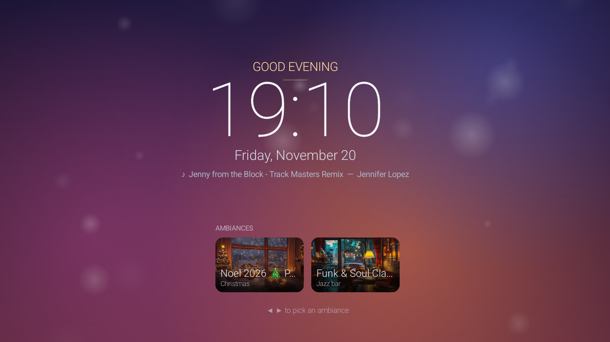
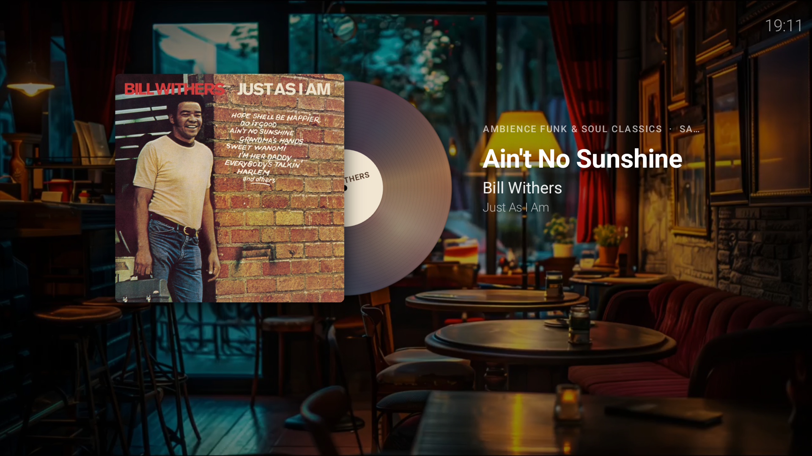
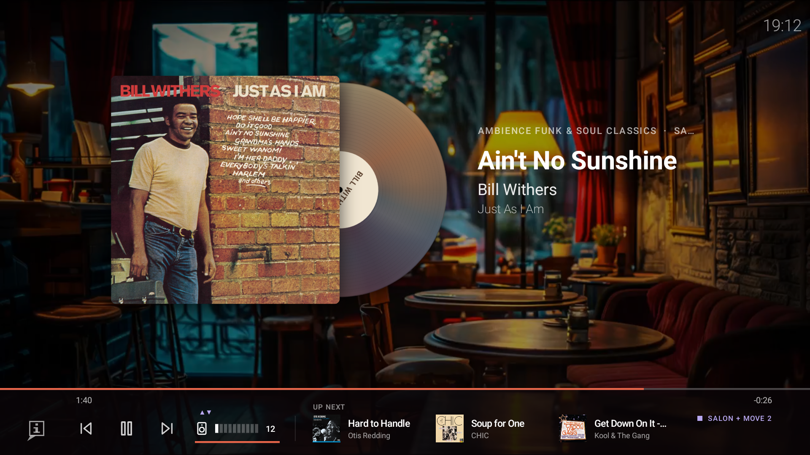
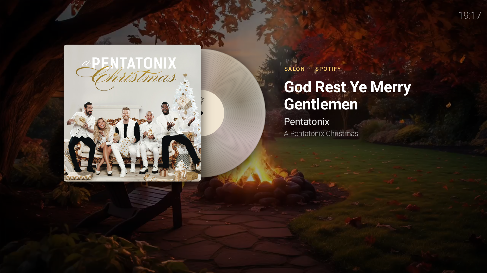
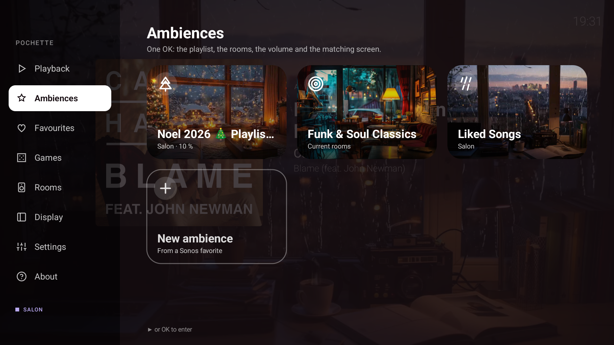
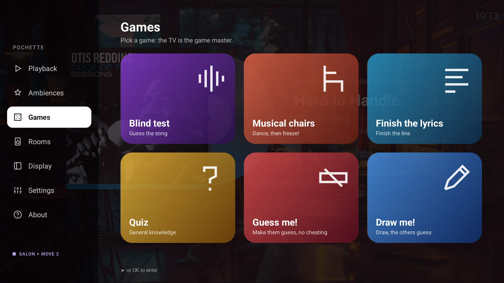
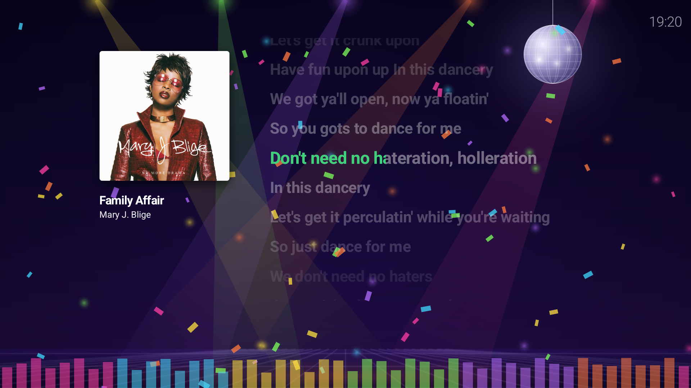
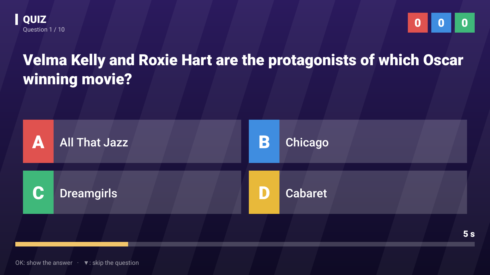
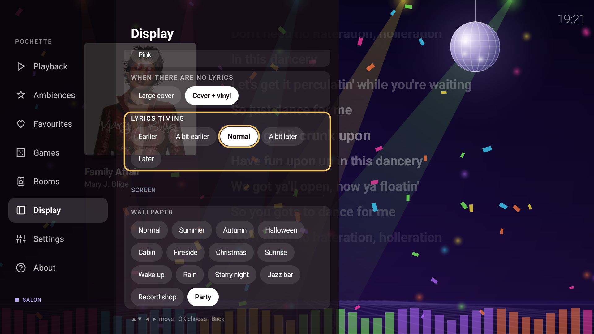

[English version](README.md)

# Pochette — écran « en cours de lecture » pour Sonos sur Android TV

Pochette remplit ta télé avec ce que joue ta Sonos : pochette, titre, artiste, barre de progression et paroles synchronisées en option.
Elle parle directement à tes enceintes sur le réseau local. Pas de compte, pas de cloud. Java pur, sans Gradle ni AndroidX, Android 6+ (cible Android 14).
Testée sur un Chromecast Google TV ; interface en français, anglais et espagnol.

## Fonctionnalités
- **QR code du Wi-Fi des invités** : première étape facultative de l'écran d'invitation (le réseau se règle une fois depuis ton téléphone, dans Réglages › Avancé › Invités).
- **Cinq styles d'affichage** : classique, illustré (disque, radio), paroles, épuré (la pochette seule) et fond d'écran seul. ▲ ▼ change de style.
- **Paroles synchronisées** depuis [LRCLIB](https://lrclib.net) (facultatif, désactivable).
- **Ambiances** : un OK lance un favori Sonos (playlist), les pièces, le volume et un fond d'écran (vidéo en boucle ou scène dessinée), avec une montée de volume au réveil et une minuterie de sommeil en option. Retour pendant la lecture ouvre l'accueil des ambiances.
- **Mode Météo** : un fond d'écran qui suit la météo et l'heure de chez toi (dégagé, nuageux, pluie, brouillard, orage, neige, coucher de soleil). Tu tapes ta ville une fois dans les Réglages, ou elle est trouvée à partir de ta position approximative (adresse IP). °C ou °F, carte météo facultative, et une démo qui montre tous les fonds.
- **Minuteur de cuisine** : icône de réveil tout à droite de la barre du bas. Choisis une durée de 1 à 240 minutes ; le compte à rebours s'affiche au-dessus de la barre pendant la dernière minute, et la sonnerie joue sur tes enceintes Sonos.
- **Volume** : les flèches règlent, un appui coupe le son, un appui long ouvre le volume pièce par pièce.
- **Sauvegarde et restauration** : Réglages › Sauvegarde et restauration affiche un QR code ; depuis ton téléphone, tu télécharges un fichier avec tes ambiances et réglages, ou tu en restaures un. Il ne contient ni mot de passe ni connexion Spotify.
- **Réorganiser les ambiances** : prends-en une avec OK, déplace-la avec les flèches.
- **Guide** : une courte visite dans l'app de la télécommande et du menu (Réglages › Guide).
- **Favoris** : lance un favori ou une playlist Sonos dans les pièces qui jouent déjà, sans toucher au volume, aux pièces ni au fond d'écran.
- **Jeux avec la télé comme maître du jeu** : blind test (avec un podium clignotant), chaises musicales, finis les paroles, quiz avec catégories à cocher (culture générale, France, Québec, geek, pop ; en français, anglais et espagnol), devine le mot et dessine-et-devine. Les téléphones se joignent par QR code, sur le même Wi-Fi.
- **Tes propres fonds d'écran** : envoie jusqu'à trois vidéos (MP4/MOV ou MKV, H.264 ou HEVC, 720p à 4K) depuis ton téléphone et donne-leur un nom.
- **Signaler un bogue** : Réglages › Avancé › « Journal et signaler un bogue… » affiche un QR code. Sur ton téléphone, tu obtiens un rapport avec les dernières lignes du journal (les identifiants de ta maison, comme les adresses IP et les identifiants Sonos, sont masqués), avec un bouton Copier et un bouton « Envoyer par courriel » vers pochette.support@gmail.com. Rien n'est envoyé si tu ne l'envoies pas toi-même.
- **File d'attente partagée** (facultative, demande Spotify) : les invités ajoutent une chanson depuis leur téléphone.
- **À suivre**, choix des pièces, mode économiseur d'écran, horloge quand rien ne joue, et un menu dessiné par l'app (elle te prévient si les sons système de la télé sont actifs, et comment les couper).

## Installation
Télécharge `Pochette.apk` depuis la page Releases et installe-le sur la télé.
- Avec un ordinateur : active les options pour développeurs et le débogage USB / sans fil sur la télé, puis `adb connect IP_DE_LA_TELE` et `adb install Pochette.apk`.
- Sans ordinateur : envoie l'APK sur la télé avec une appli comme *Send Files to TV* et ouvre-le (autorise les installations depuis cette appli).

La télé et la Sonos doivent être sur le même réseau. Si aucune enceinte n'est trouvée, entre l'IP d'une enceinte dans Réglages › Plus › Avancé.

## Télécommande
| Touche | Action |
|---|---|
| ▲ / ▼ (menu fermé) | Changer de style d'affichage |
| Maintenir ◀ / ▶ | Reculer / avancer dans le morceau |
| OK, ◀ ou ▶ | Afficher les commandes et le menu |
| Retour (pendant la lecture) | Accueil des ambiances ; Retour encore quitte |

## Astuce : utilise les favoris Sonos
La façon la plus fiable de jouer de la musique est d'ajouter tes playlists (Spotify, Apple Music, radios) à **Mes favoris Sonos** dans l'appli Sonos, puis de les lancer depuis les Favoris de Pochette ou une ambiance. Sonos met alors lui-même la musique en file d'attente : « À suivre » et le saut vers un titre fonctionnent partout de la même façon.

## Spotify (facultatif)
Les favoris et le titre suivant fonctionnent sans compte Spotify : Pochette parle aussi à l'API websocket locale de ton enceinte (l'idée vient d'un commentaire Reddit), qui ouvre les favoris Spotify quand UPnP les refuse (certaines installations répondent l'erreur 804) et montre le titre suivant pendant Spotify Connect. Si Sonos ne donne pas de pochette pour ce titre, Pochette la cherche par artiste et titre sur Deezer, puis iTunes Search (voir `PRIVACY.md`).

Pour une liste « À suivre » plus longue et la file partagée (les invités cherchent et ajoutent des chansons), crée une appli sur le [tableau de bord développeur Spotify](https://developer.spotify.com/dashboard), puis Réglages › Plus › Spotify et suis la page sur ton téléphone. Pochette utilise ton propre Client ID ; l'API Web de Spotify demande un compte Premium.

## Compiler
```
sudo apt install openjdk-17-jdk aapt zipalign apksigner dalvik-exchange android-sdk-platform-23
./build.sh
```
`build.sh` crée une clé de signature (`pochette.keystore`) au premier lancement. Garde-la : une mise à jour ne s'installe par-dessus une ancienne version que si elle est signée avec la même clé.
Les vidéos d'ambiance de `res/raw/` ne sont pas sous licence GPL : elles viennent de Pixabay et gardent leur propre licence (voir `NOTICE.md`). Sans elles, l'app compile quand même et les ambiances affichent un dégradé.

## Organisation du code
Les sources sont dans `src/app/pochette/tv/` :
- `core/` préférences, traductions (`T`), état de la lecture, liste des ambiances, utilitaires
- `sonos/` `SonosClient` (UPnP/SOAP local), `SonosWs` (API websocket locale) et `Poller` (état, file d'attente, ambiances)
- `spotify/` client de l'API Web et configuration depuis le téléphone
- `media/` paroles (LRCLIB) et biographie de l'artiste
- `ui/` `NowPlayingView` (rendu), `MenuOverlay`, outils de dessin (`IdleScreen`, `DiscArt`, `RadioScene`, `Icons`, `Draw`), vues d'info et de partage, fond vidéo
- `theme/` fonds d'écran : `Themes`, `Scenes*`, `ThemePreview`
- `party/` jeux, pages pour téléphone et serveur de la file partagée
- `menu/` contrôleurs de menu (ambiances, jeux, pièces, réglages, favoris)
- `MainActivity` relie le tout et aiguille les touches de la télécommande

## Sans affiliation
Projet indépendant, sans lien avec Sonos, Inc. ni Spotify AB. Sonos et Spotify sont des marques de leurs propriétaires, citées ici seulement pour dire avec quoi Pochette fonctionne. Sonos s'appuie sur une API locale non officielle qui peut changer. Voir `NOTICE.md`. Code sous GNU GPL v3 (`LICENSE`), sauf les vidéos et les questions du quiz (voir `NOTICE.md`) : si tu distribues une version modifiée, tu dois en partager le code source sous la même licence. Copyright (C) 2026 Pochette contributors. Les versions publiées avant le 24 novembre 2026 (jusqu'à la 1.0.32) l'ont été sous licence MIT et le restent. Développé avec l'IA Claude.

## Crédits
Vidéos d'ambiance de [Pixabay](https://pixabay.com), sous la Pixabay Content License. Merci à leurs auteurs : Monk_Vadim, JusticeTran, LofiPlace, Joe_hackney, BackgroundsCHAIR, victorsteep, doktorkleinmusic, Girl_From_Nowhere, Phile-Rain, Nils_Vega, dlabiebrzy et Pauline_17 (liens dans `NOTICE.md`). Les prévisions viennent d'[Open-Meteo](https://open-meteo.com).

Les questions du quiz viennent d'[Open Trivia DB](https://opentdb.com) (CC BY-SA 4.0), choisies et traduites en français et en espagnol, plus des questions geek originales. Les fichiers du quiz restent sous CC BY-SA 4.0, sauf les questions originales (voir `NOTICE.md`).

## Captures d'écran

 
 
 
 


## Vie privée
Pochette ne collecte aucune donnée. La météo demande à un service météo public le temps de ta ville ; voir [PRIVACY.md](PRIVACY.md).
