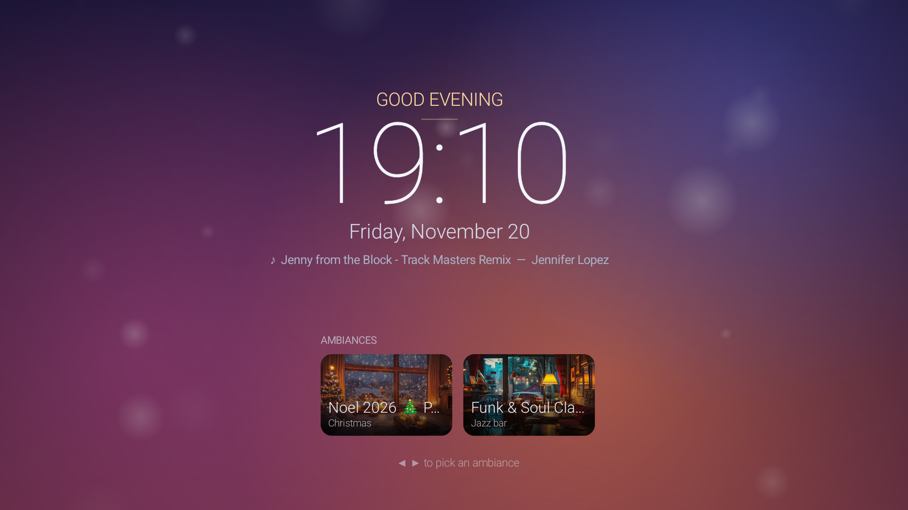
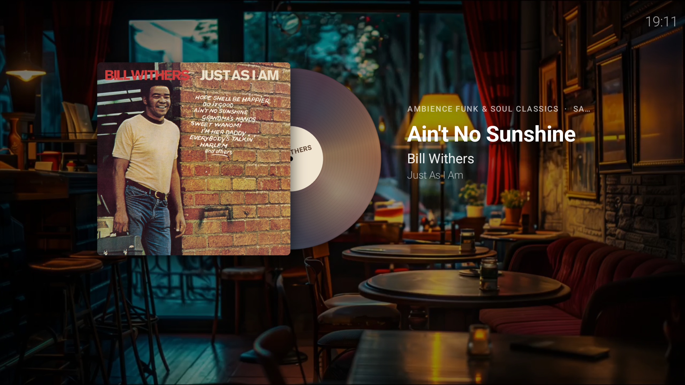
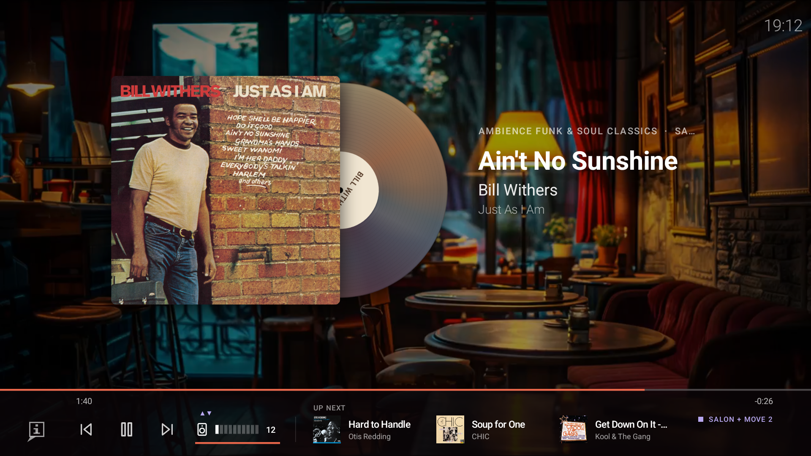
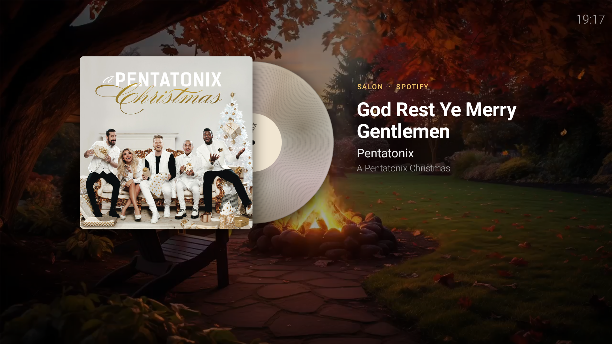
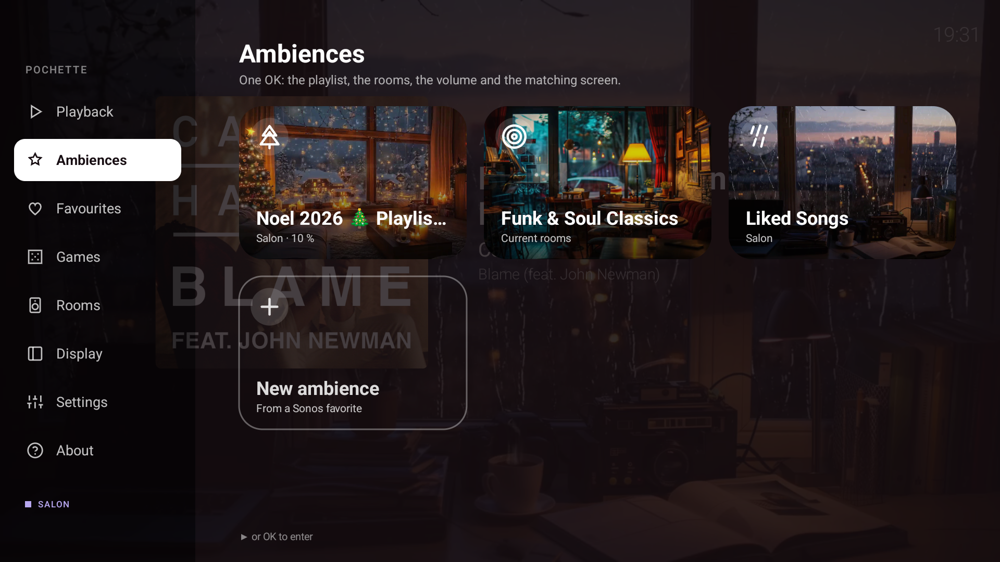
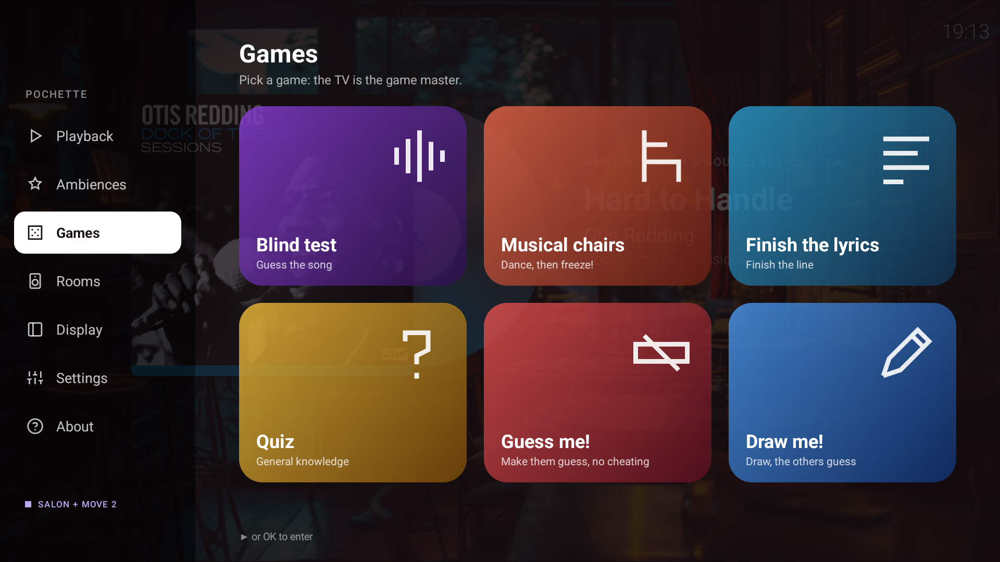
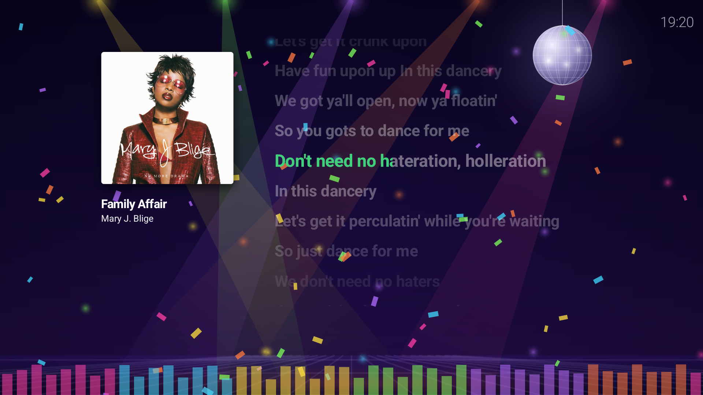
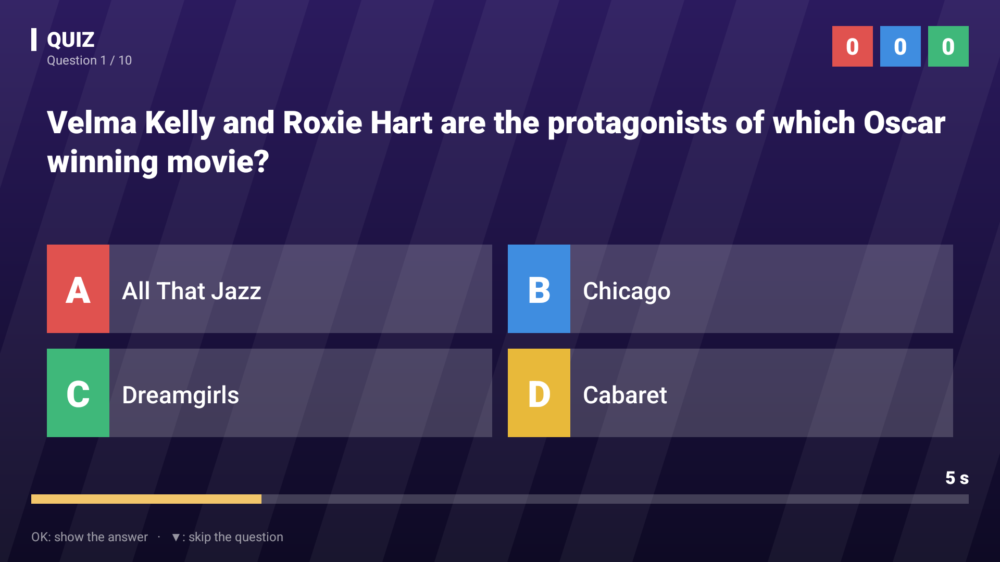
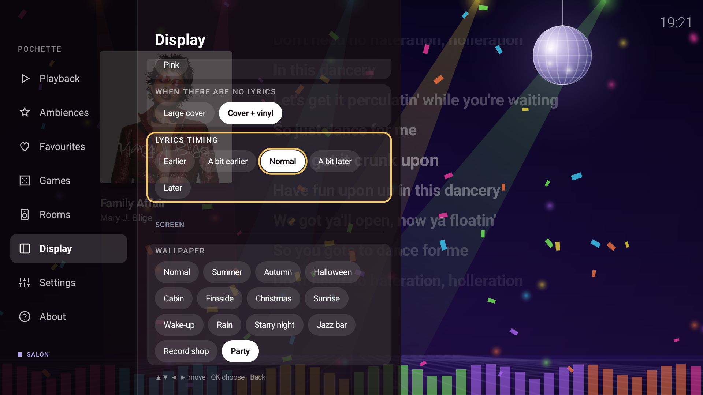

[Version française](README.fr.md)

# Pochette — a "now playing" screen for Sonos on Android TV

Pochette fills your TV with what your Sonos is playing: cover art, title, artist, progress bar and optional synced lyrics.
It talks straight to your speakers on the local network. No account, no cloud. Plain Java, no Gradle, no AndroidX, Android 6+ (targets Android 14).
Tested on a Google TV Chromecast; interface in English, French and Spanish.

## Features
- **Guest Wi-Fi QR**: optional first step of the invitation screen (set the network once from your phone in Settings › Advanced › Guests).
- **Four display styles**: classic, illustrated (record, radio), lyrics, and wallpaper only. Up/Down switches style.
- **Synced lyrics** from [LRCLIB](https://lrclib.net) (optional, can be turned off).
- **Ambiances**: one OK starts a Sonos favourite (playlist), the rooms, the volume and a wallpaper (looping video or drawn scene), with an optional wake-up volume ramp and sleep timer. Back during playback opens the ambiance home.
- **Favourites**: play a Sonos favourite or playlist in the rooms already playing, without touching volume, rooms or wallpaper.
- **Games with the TV as game master**: blind test (with a blinking winner podium), musical chairs, finish-the-lyrics, quiz with tick-box categories (general culture, France, Québec, geek, pop; French, English and Spanish), guess-the-word and draw-and-guess. Phones join by QR code on the same Wi-Fi.
- **Your own wallpapers**: send up to three videos (MP4/MOV or MKV, H.264 or HEVC, 720p to 4K) from your phone and name them.
- **Report a bug**: Settings › Advanced › "Log and report a bug…" shows a QR code. On your phone you get a report with the last journal lines (home identifiers such as IP addresses and Sonos IDs are masked), with a Copy button and a "Send by e-mail" button to pochette.support@gmail.com. Nothing is sent unless you send it yourself.
- **Shared queue** (optional, needs Spotify): guests add a song from their phone.
- **Up next**, rooms picker, screensaver mode, clock when idle, and a menu drawn by the app (it warns you if the TV's system click sounds are on, and how to turn them off).

## Install
Download `Pochette.apk` from the Releases page and install it on the TV.
- With a computer: enable Developer options and USB / wireless debugging on the TV, then `adb connect TV_IP` and `adb install Pochette.apk`.
- Without a computer: put the APK on the TV with an app such as *Send Files to TV* and open it (allow installs from that app).

The TV and the Sonos must be on the same network. If no speaker is found, enter a speaker's IP in Settings › More › Advanced.

## Remote control
| Key | Action |
|---|---|
| Up / Down (menu closed) | Change display style |
| Hold Left / Right | Seek in the track |
| OK, Left or Right | Show controls and menu |
| Back (during playback) | Ambiance home; Back again quits |

## Spotify (optional)
Favourites and the next track work without any Spotify account: Pochette also talks to your speaker's local websocket API (the idea came from a Reddit comment), which opens Spotify favourites when UPnP refuses them (some setups answer error 804) and shows the next track while Spotify Connect plays. If Sonos gives no cover for that next track, Pochette looks it up by artist and title on Deezer, then iTunes Search (see `PRIVACY.md`).

For a longer "up next" list and the shared queue (guests search and add songs), create an app on the [Spotify developer dashboard](https://developer.spotify.com/dashboard), then Settings › More › Spotify and follow the phone page. Pochette uses your own Client ID; the Spotify Web API needs a Premium account.

## Build
```
sudo apt install openjdk-17-jdk aapt zipalign apksigner dalvik-exchange android-sdk-platform-23
./build.sh
```
`build.sh` creates a signing key (`pochette.keystore`) on first run. Keep it: updates only install over an older build signed with the same key.
The ambiance videos in `res/raw/` are not under the GPL license: they come from Pixabay and keep their own license (see `NOTICE.md`). Without them the app still builds and the ambiances show a gradient.

## Layout of the code
Sources live in `src/app/pochette/tv/`:
- `core/` preferences, translations (`T`), track state, ambiance list, helpers
- `sonos/` `SonosClient` (local UPnP/SOAP), `SonosWs` (local websocket API) and `Poller` (state, queue, ambiances)
- `spotify/` Web API client and the phone-based setup flow
- `media/` lyrics (LRCLIB) and artist bio
- `ui/` `NowPlayingView` (rendering), `MenuOverlay`, drawing helpers (`IdleScreen`, `DiscArt`, `RadioScene`, `Icons`, `Draw`), info/share views, video background
- `theme/` wallpapers: `Themes`, `Scenes*`, `ThemePreview`
- `party/` games, phone pages and the shared queue server
- `menu/` menu controllers (ambiances, games, rooms, settings, favorites)
- `MainActivity` wires everything and routes remote-control keys

## Not affiliated
Independent project, not affiliated with Sonos, Inc. or Spotify AB. Sonos and Spotify are trademarks of their owners, named here only to say what Pochette works with. Sonos relies on an unofficial local API that may change. See `NOTICE.md`. Code under the GNU GPL v3 (`LICENSE`), except the videos and the quiz questions (see `NOTICE.md`): if you distribute a modified version, you must share its source code under the same license. Copyright (C) 2026 Pochette contributors. Versions published before 24 November 2026 (up to 1.0.32) were released under the MIT license and stay under it. Developed with the Claude AI.

## Credits
Ambiance videos from [Pixabay](https://pixabay.com), under the Pixabay Content License. Thanks to their authors: Monk_Vadim, JusticeTran, LofiPlace, Joe_hackney, BackgroundsCHAIR and victorsteep (links in `NOTICE.md`).

Quiz questions come from [Open Trivia DB](https://opentdb.com) (CC BY-SA 4.0), selected and translated into French and Spanish, plus original geek questions. The quiz files stay under CC BY-SA 4.0, except the original questions (see `NOTICE.md`).

## Screenshots

 
 
 
 


## Privacy
Pochette collects no data. See [PRIVACY.md](PRIVACY.md).
